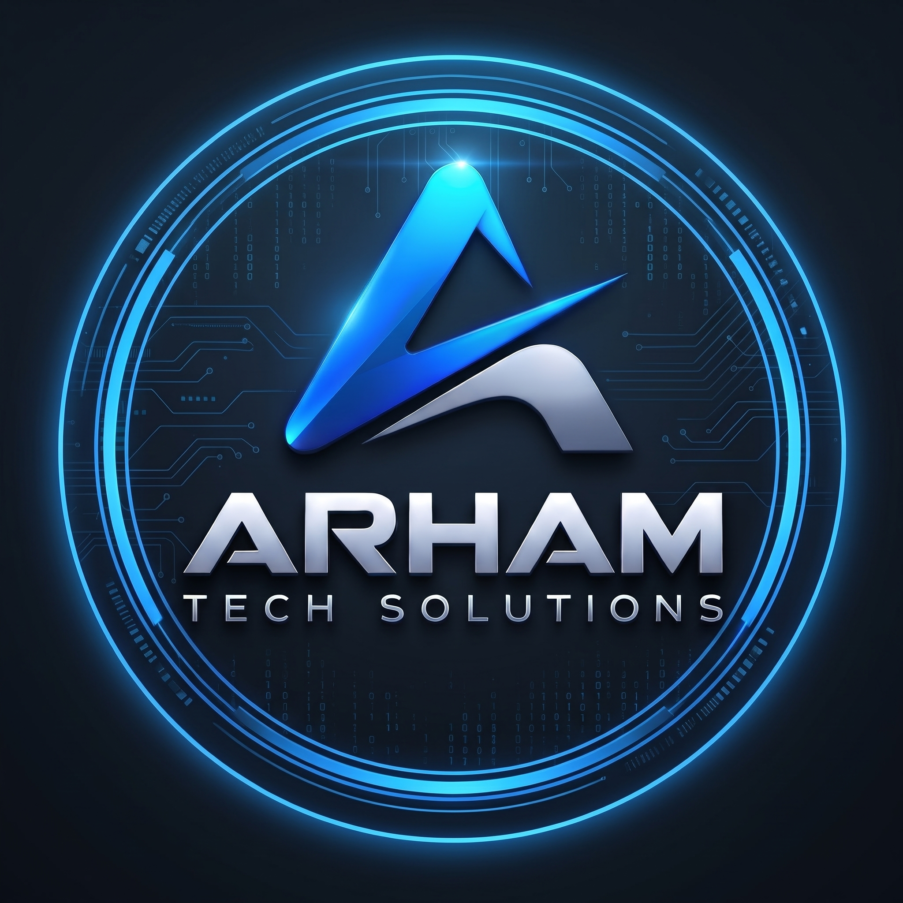

<div align="center">

  

  # ARHAM TECH SOLUTIONS
  ### Premium Animated Software Development Agency Portfolio

  <p>
    <strong>Your Vision. Our Expertise.</strong><br />
    <em>Ideas • Technology • Growth</em>
  </p>

  <p>
    <a href="https://arhamtechsolutions.github.io/arham-tech-solutions-portfolio/"></a>
    <a href="https://github.com/arhamtechsolutions/arham-tech-solutions-portfolio/actions"></a>
    <a href="https://instagram.com/arhamtech.dev"></a>
    <a href="mailto:arhamtech052@gmail.com"></a>
  </p>

  <p>
    
    
    
    
    
    
    
  </p>

</div>

---

## 📖 Overview

**ARHAM TECH SOLUTIONS** is an ultra-premium, visually stunning, fully animated portfolio website engineered for an elite software development agency. Designed with an award-winning digital experience in mind, it unites futuristic dark-mode aesthetics, interactive 3D WebGL graphics (`Three.js`), fluid kinetic typography, and physics-based micro-interactions.

### 🌐 Live Production Deployment
- **Official GitHub Pages URL:** [https://arhamtechsolutions.github.io/arham-tech-solutions-portfolio/](https://arhamtechsolutions.github.io/arham-tech-solutions-portfolio/)
- **Repository:** `arhamtechsolutions/arham-tech-solutions-portfolio`

---

## 🎨 Visual Identity & Brand System

| Element | Specification | Hex / Value |
| :--- | :--- | :--- |
| **Primary Color** | Premium Red | `#FF1738` |
| **Secondary Background**| Deep Black | `#05070B` |
| **Main Background** | Dark Charcoal | `#0B0D12` |
| **Accent Glow** | Electric Blue / Neon Cyan | `#00E5FF` |
| **Typography** | Space Grotesk, Syne, JetBrains Mono | Geometric Modern |
| **Primary CTA** | Electric Blue Gradient | `#00E5FF` ➔ `#0066FF` |
| **Secondary CTA** | Translucent Frosted Glass | `#FFFFFF` |

---

## ⚡ Core Sections & Feature Highlights

1. **Cinematic Intro Preloader (`Preloader.tsx`)**
   - High-tech loading sequence with percentage counter (0% to 100%), shader calibration status, and animated logo frame.
2. **Interactive 3D WebGL Canvas (`HeroCanvas.tsx`)**
   - Procedurally generated 3D abstract 'A' brand emblem with dynamic metallic chrome and electric blue shaders.
   - Dual-color particle field (Red & Cyan), gyroscopic orbital rings, and mouse-follow parallax with inertial damping.
3. **Hero Section (`Hero.tsx`)**
   - Real-time availability indicator: `"● Available for New Projects | Q1 2026"`.
   - Interactive `ArhamEngine.dart` live code terminal with build telemetry.
   - Floating glassmorphism tech badges and custom animated scroll indicator.
4. **Behind the Technology (`About.tsx`)**
   - Animated verified stats (45+ Products Delivered, 99% Satisfaction, 100% On-Time, 24/7 Support).
   - Mission, Vision, and professional engineering approach.
   - Holographic brand showcase displaying the ARHAM TECH SOLUTIONS emblem.
5. **Services Section — What We Do (`Services.tsx` & `ServiceModal.tsx`)**
   - 6 Interactive 3D tilt cards with red & electric blue glowing borders:
     - `01 — Flutter App Development` (Android, iOS, Cross-Platform, API Integration)
     - `02 — Website Development` (Laravel, Core PHP, Custom Web Apps, Business Sites)
     - `03 — UI/UX & Web Design` (Website UI/UX, Mobile App UI/UX, Responsive Interfaces, Design Systems)
     - `04 — Database Solutions` (MySQL, Database Architecture, Optimization, Secure Data Management)
     - `05 — SEO & Digital Marketing` (Technical SEO, On-Page SEO, Website Optimization, Search Growth)
     - `06 — Ads Management` (Social Media Advertising, Campaign Management, Audience Targeting, ROAS Optimization)
   - Interactive "Learn More" modal featuring deliverable checklists and timelines.
6. **Selected Work Portfolio (`Portfolio.tsx` & `ProjectModal.tsx`)**
   - Filterable categories: `All`, `Mobile Applications`, `Websites`, `Ecommerce`, `Web Applications`, `UI/UX Design`.
   - Hover zoom effects, live preview links, and interactive **Case Study Modal** with architectural challenges, solutions, and metrics.
7. **Technology Stack (`TechStack.tsx`)**
   - High-fidelity official SVG icons for: Flutter, Dart, Laravel, PHP, HTML5, CSS3, JavaScript, MySQL, Bootstrap, REST APIs, Git, Figma.
   - Animated proficiency progress meters with category filtering.
8. **Development Process (`Process.tsx`)**
   - 5-stage connected timeline: `Discover` ➔ `Strategy` ➔ `Design` ➔ `Development` ➔ `Launch`.
9. **Why Choose Us (`WhyUs.tsx`)**
   - 8 interactive cards covering Modern Tech, Clean Code, User-Centered Design, Responsive Development, Performance Optimization, Security, Professional Communication, and Reliable Support.
10. **Client Trust & Testimonials (`Testimonials.tsx`)**
    - Authentic client reviews with 5-star ratings and company affiliations.
    - Integrated interactive feedback modal that stores and displays verified feedback via local storage.
11. **Conversion-Driven Contact Section (`Contact.tsx`)**
    - Validated inquiry form with Project Type pills, Budget Range selectors, and message input.
    - Direct WhatsApp quick chat (`+60 111-137-5876`), Email (`arhamtech052@gmail.com`), and Instagram (`@arhamtech.dev`).
    - Celebratory confetti explosion on inquiry dispatch.
12. **Agency Footer (`Footer.tsx`)**
    - Brand identity, tagline, quick links, capabilities index, social media icons, and animated back-to-top button.
13. **Custom Precision Cursor (`CustomCursor.tsx`)**
    - Dual-ring magnetic cursor with desktop pointer detection and automatic mobile/touch device bypass.

---

## 📂 Project Architecture

```
arham-tech-solutions-portfolio/
├── .github/
│   └── workflows/
│       └── deploy.yml          # Automated GitHub Pages CI/CD workflow
├── public/
│   ├── logo.jpg                # High-res official brand emblem
│   └── banner.svg              # GitHub repository & profile banner
├── src/
│   ├── assets/
│   │   └── logo.jpg            # Bundled & hashed logo asset
│   ├── components/
│   │   ├── CustomCursor.tsx    # Precision magnetic mouse follower
│   │   ├── Preloader.tsx       # Cinematic brand intro loader
│   │   ├── Navbar.tsx          # Floating glassmorphic navigation
│   │   ├── Hero.tsx            # Full-screen cinematic hero
│   │   ├── HeroCanvas.tsx      # Three.js 3D WebGL abstract 'A' canvas
│   │   ├── About.tsx           # Brand story, mission, verified stats
│   │   ├── Services.tsx        # 6 Interactive 3D tilt service cards
│   │   ├── ServiceModal.tsx    # Detailed service breakdown modal
│   │   ├── Portfolio.tsx       # Filterable showcase with case studies
│   │   ├── ProjectModal.tsx    # Deep-dive architecture case study viewer
│   │   ├── TechStack.tsx       # 12 Frameworks with mastery gauges
│   │   ├── Process.tsx         # 5-Stage connected agile timeline
│   │   ├── WhyUs.tsx           # 8 Core value proposition cards
│   │   ├── Testimonials.tsx    # Verified reviews & client submission
│   │   ├── Contact.tsx         # Form validation & WhatsApp integration
│   │   ├── Footer.tsx          # Agency footer, navigation & socials
│   │   └── SocialIcons.tsx     # Custom SVG brand icons
│   ├── data/
│   │   ├── services.ts         # Services specifications & deliverables
│   │   ├── projects.ts         # Portfolio projects & architecture metrics
│   │   ├── technologies.ts     # Tech stack definitions & colors
│   │   ├── process.ts          # 5-stage lifecycle milestones
│   │   ├── whyUs.ts            # Value proposition metrics
│   │   ├── testimonials.ts     # Verified client feedback
│   │   └── stats.ts            # Verified agency performance numbers
│   ├── styles/
│   │   └── index.css           # Tailwind base, utilities & cyber grids
│   ├── types/
│   │   └── index.ts            # Full TypeScript interfaces
│   ├── App.tsx                 # Master layout & choreography
│   ├── main.tsx                # React 19 entry point
│   └── vite-env.d.ts           # Type declarations
├── .env.example                # Safe environment variable template
├── .gitignore                  # Git ignore rules for node_modules, dist, etc.
├── LICENSE                     # MIT License
├── package.json                # Dependencies & scripts
├── postcss.config.js           # PostCSS configuration
├── tailwind.config.js          # Extended brand colors & animations
├── tsconfig.json               # TypeScript compiler config
└── vite.config.ts              # Vite 6 config with vendor chunking & base path
```

---

## 🛠️ Local Development Setup

### Prerequisites
- **Node.js**: v18.0.0 or higher (v20+ recommended)
- **npm**: v9.0.0 or higher

### 1. Clone the Repository
```bash
git clone https://github.com/arhamtechsolutions/arham-tech-solutions-portfolio.git
cd arham-tech-solutions-portfolio
```

### 2. Install Dependencies
```bash
npm install
```

### 3. Start Development Server
```bash
npm run dev
```
Navigate to `http://localhost:3000` to preview the live application.

### 4. Build for Production
```bash
npm run build
```
Compiles and generates an optimized production bundle in the `dist/` folder with vendor chunk splitting:
- `three-vendor`: Three.js 3D rendering engine
- `motion-vendor`: Framer Motion animation engine
- `icons-vendor`: Lucide icon bundle

### 5. Preview Production Build
```bash
npm run preview
```

---

## 🚀 Deployment Instructions

### Automatic Deployment via GitHub Actions (Recommended)
This repository is pre-configured with `.github/workflows/deploy.yml`.

1. Push your code to the `main` branch:
   ```bash
   git add .
   git commit -m "feat: complete ARHAM TECH SOLUTIONS portfolio ecosystem"
   git branch -M main
   git push -u origin main
   ```
2. In your GitHub repository:
   - Navigate to **Settings** ➔ **Pages**.
   - Under **Build and deployment** ➔ **Source**, select **GitHub Actions**.
3. Every subsequent push to `main` will automatically build and deploy the website to:
   ```
   https://arhamtechsolutions.github.io/arham-tech-solutions-portfolio/
   ```

### Custom Domain Setup (Optional)
To attach a custom domain (e.g., `https://arhamtech.dev`):
1. In repository **Settings** ➔ **Pages**, enter your custom domain under **Custom domain**.
2. Configure your DNS provider with CNAME or A records pointing to GitHub Pages.
3. Check **Enforce HTTPS**.

---

## 🔒 Security & Quality Assurance

- **No Secrets or Credentials**: No API keys, passwords, or private environment variables are committed.
- **Strictly Typed**: Validated with zero TypeScript warnings or errors (`tsc`).
- **Accessible & Responsive**: Fully optimized across Mobile, Tablet, Desktop, and Ultrawide viewports.
- **Smooth Performance**: Vendor chunk separation and hardware-accelerated 60+ FPS animations.

---

## 📬 Connect With Us

- **Website**: [arhamtechsolutions.github.io/arham-tech-solutions-portfolio](https://arhamtechsolutions.github.io/arham-tech-solutions-portfolio/)
- **Instagram**: [@arhamtech.dev](https://instagram.com/arhamtech.dev)
- **Official Email**: [arhamtech052@gmail.com](mailto:arhamtech052@gmail.com)
- **WhatsApp**: [+60 111-137-5876](https://wa.me/601111375876)

<div align="center">
  <sub>© 2026 ARHAM TECH SOLUTIONS. All rights reserved.</sub><br />
  <sub><strong>Ideas • Technology • Growth</strong></sub>
</div>
